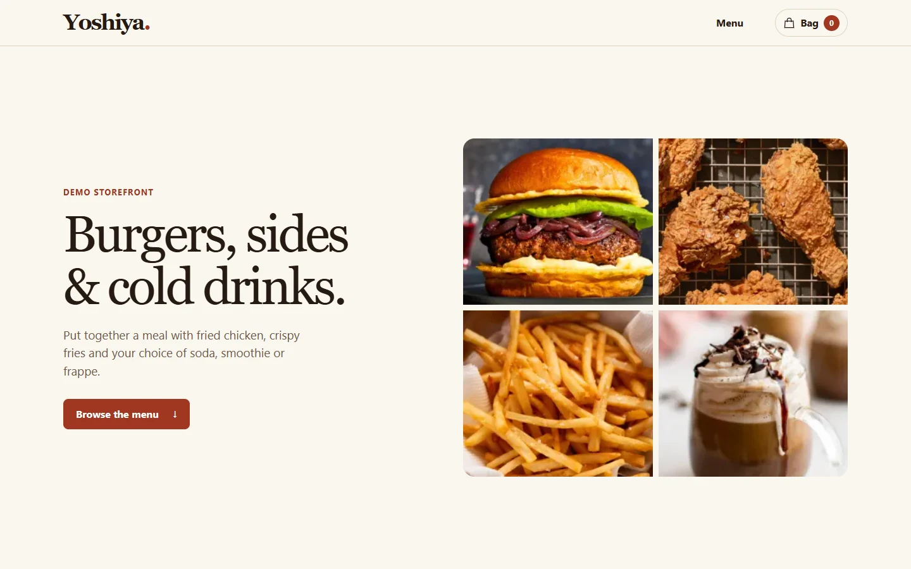

<p align="center">
  
</p>

<p align="center">
  <strong>A restaurant storefront that takes shoppers from browsing the menu to submitting an order.</strong>
</p>

<p align="center">
  
  
  
  
  <br>
  
</p>

<p align="center">
  <a href="#overview">Overview</a> ·
  <a href="#features">Features</a> ·
  <a href="#tech-stack">Tech Stack</a> ·
  <a href="#project-structure">Project Structure</a> ·
  <a href="#getting-started">Getting Started</a>
</p>

---

## Overview

Yoshiya rebuilds an earlier food and drinks storefront around a complete ordering flow. The rebuild carries forward the original 15-item menu and product photography, adds a credential-free demo, and moves order submission into a single Postgres transaction.



## Features

- **Searchable menu.** Search by product name, filter by category, and open individual product pages.
- **Persistent bag.** Update quantities and refresh the page without losing the bag.
- **Scroll-driven burger assembly.** Layers from the original product photo come together as visitors scroll. Reduced-motion settings show the assembled burger.

### Engineering highlights

| Area | Implementation |
| --- | --- |
| **Demo without credentials** | A bundled catalog and simulated receipt let reviewers try the ordering flow locally. Demo orders do not store submitted details. [View data layer](lib/store.ts) |
| **Checkout validation** | The API validates contact details and quantities. Postgres rechecks availability and prices and writes the order and line items in one transaction. [View order route](app/api/orders/route.ts) |
| **Safe retries** | Submitting the same request ID with the same details returns the existing receipt. A reused ID with different details returns a conflict. [View SQL migration](supabase/migrations/20261109000100_storefront.sql) |
| **Data access** | Anonymous users can read available products. The server-side checkout uses a separate key to submit orders. [View access policies](supabase/migrations/20261109000100_storefront.sql) |

## Tech Stack

| Layer | Tools |
| --- | --- |
| Interface | Next.js App Router, React, TypeScript, CSS |
| Server | Node.js and Next.js Route Handlers |
| Data | Supabase, PostgreSQL, SQL migrations, and row-level security |

## Project Structure

| Directory | What you'll find |
| --- | --- |
| [`app/`](app) | Storefront, product pages, cart, and order endpoint |
| [`components/`](components) | Menu filters, browser-local bag, and burger animation |
| [`lib/`](lib) | Catalog access, checkout validation, and order submission |
| [`data/`](data) | Bundled demo catalog |
| [`supabase/migrations/`](supabase/migrations) | Database schema, checkout function, and catalog seed |

## Getting Started

Use Node.js 20.9 or later.

```sh
git clone --branch codex/storefront-rebuild https://github.com/Yoshi-dev-mode/e-commerce-website-project.git
cd e-commerce-website-project
npm ci
npm run dev
```

Open the storefront with all Supabase variables unset to start in demo mode. Add an item, refresh to check that the bag persists, then submit an order with sample details to see the receipt. [Open localhost:3000](http://localhost:3000)

```sh
npm run check
npm run build
```

## Connect Supabase

Use a Supabase project with the storefront schema and seed data applied. For a new project, link it with the Supabase CLI, review the dry run, and apply the two migrations. [View migrations](supabase/migrations)

```sh
supabase init
supabase login
supabase link --project-ref YOUR_PROJECT_REF
supabase db push --dry-run
supabase db push
```

Run `supabase init` once if the checkout lacks a Supabase configuration. Copy `.env.example` to `.env.local`, fill in the following values from your Supabase project settings, and restart Next.js. [View environment template](.env.example)

| Variable | Purpose |
| --- | --- |
| `SUPABASE_URL` | Supabase project URL |
| `SUPABASE_PUBLISHABLE_KEY` | Catalog read access |
| `SUPABASE_SECRET_KEY` | Server-only order submission. Keep this key out of source control. |

Orders enter the database with a `received` status. The store arranges payment after confirming the request. Deploy with a Next.js server and the same environment variables.

<details>
<summary>Catalog migration notes</summary>

The seed carries forward 13 products from the earlier PostgreSQL database and two drinks from the repository seed. It retains the source records in the restricted `legacy_record` column, standardizes display names, shortens descriptions, and interprets the original dollar prices as USD. The rebuilt storefront stores each bag in the shopper's browser.

</details>
